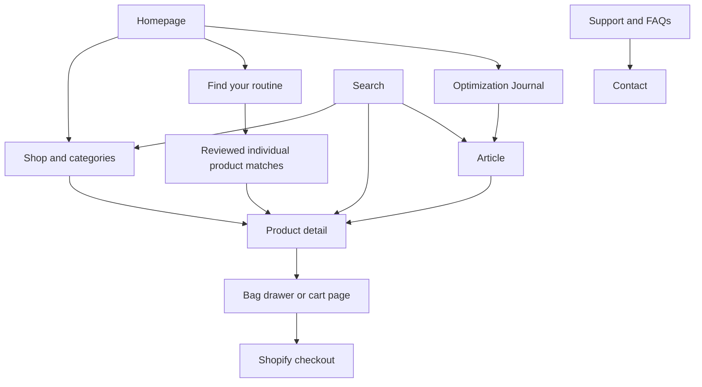

# Information architecture and content map

## Primary journeys

The diagram describes intended navigation, not implemented functionality. Quiz matching is gated by the decision register; its missing-rules path goes to real collections.

## Header

Shop All → `/collections/all`. Protein, Recovery and Wellness → actual configured collection destinations, to be confirmed rather than fabricated if missing. Learn → `/blogs/news`. Search and bag are always reachable. Account uses actual platform routes. Bestsellers is a merchant-curated group or a verified ranking; absent evidence, use Featured. Avoid exposing empty bundles or a subscription program that is not configured.

On desktop, a new V3 submenu can list real subcategories with a text link to View all. Keep imagery out of the menu unless a distinct asset is commissioned. On phone, simple expandable link groups avoid the need for tiny category cards or repeated homepage photography.

## Footer

Shop: Shop all and real collections. Learn: journal, product information/standards, routine quiz if enabled. Support: contact, FAQs, shipping/returns and current policies. About can appear in Learn or a small brand link group depending menu length. Wholesale appears only when its form and merchant process are ready. Subscription navigation stays hidden without actual plans. Social icons are omitted until real URLs are supplied.

## URL preservation

Retain current product handles from the product source registry and current blog handle `news` unless a separate migration is approved. Do not rename `true-omega` or `true-greens` merely to match a display title. Proposed new `/pages/` handles in the registry are design destinations, not evidence that those pages already exist. Establish them in admin during implementation. If replacing a genuine existing URL, record the old/new mapping and verify redirects rather than silently breaking inbound links.

## Content hierarchy

Home introduces and directs. Shop compares and narrows. Category focuses. PDP explains and transacts. Quiz discovers without diagnosis. Journal educates. About and standards explain the company and information access. Support resolves practical problems. Policies retain their authoritative legal text. Accounts and checkout remain platform-owned handoffs unless inspected configuration proves otherwise.

## Content duplication rule

Shared labels and new components can repeat because they help orientation. Long sales sections and editorial photography should not repeat on every page. One contextual next action per region is enough; do not place the same quiz tile both in a product grid and immediately below it. A functional search or contact page does not need a promotional stone hero.
